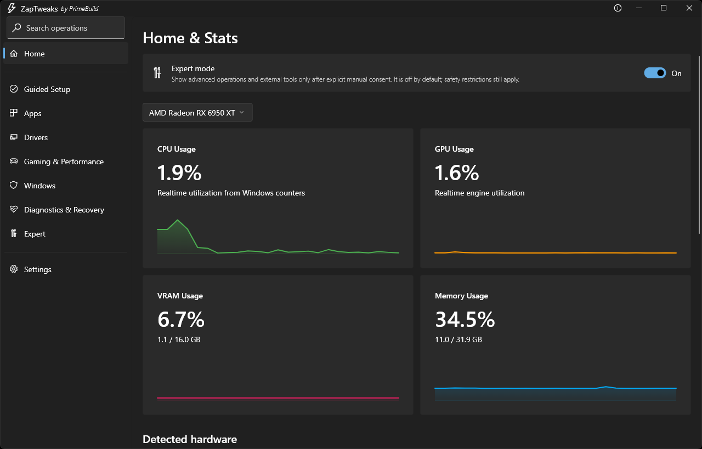
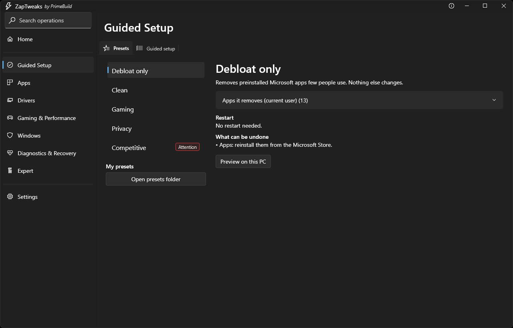
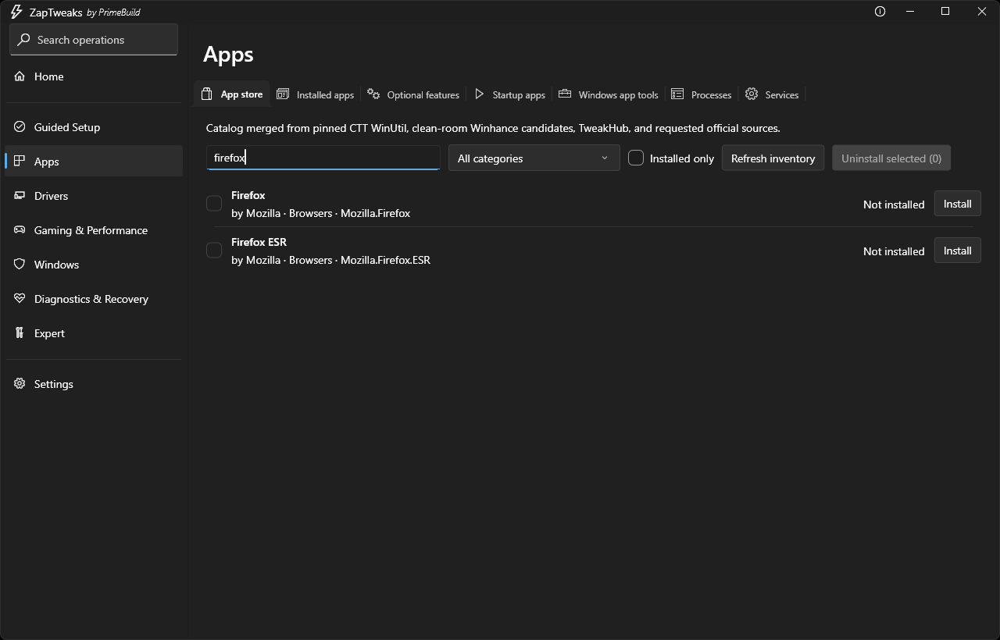
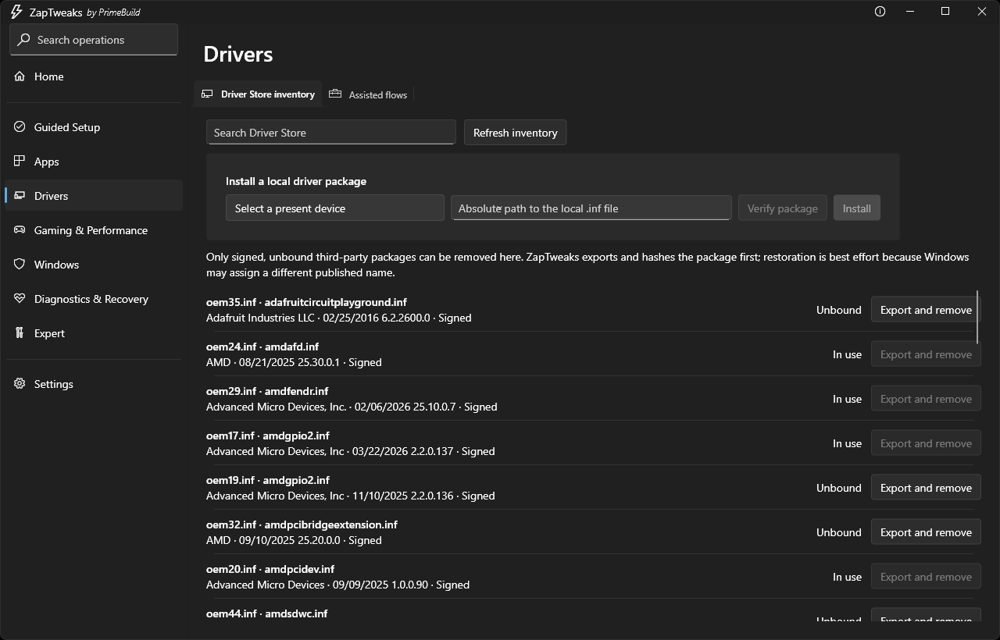
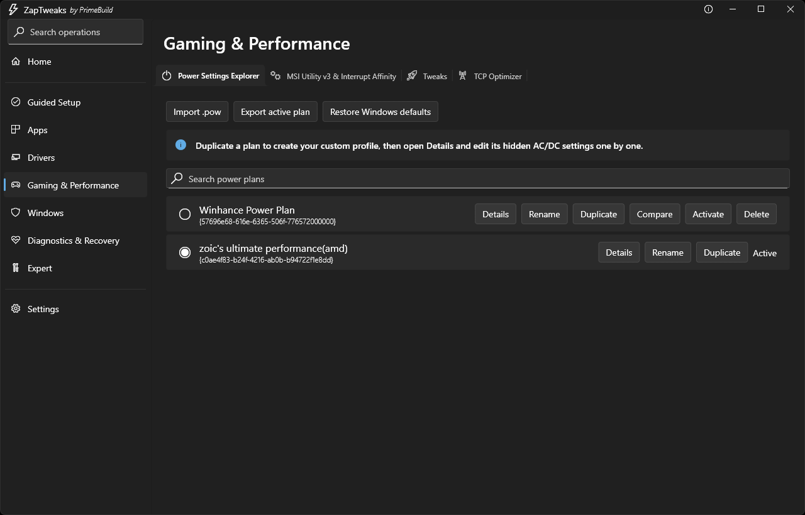
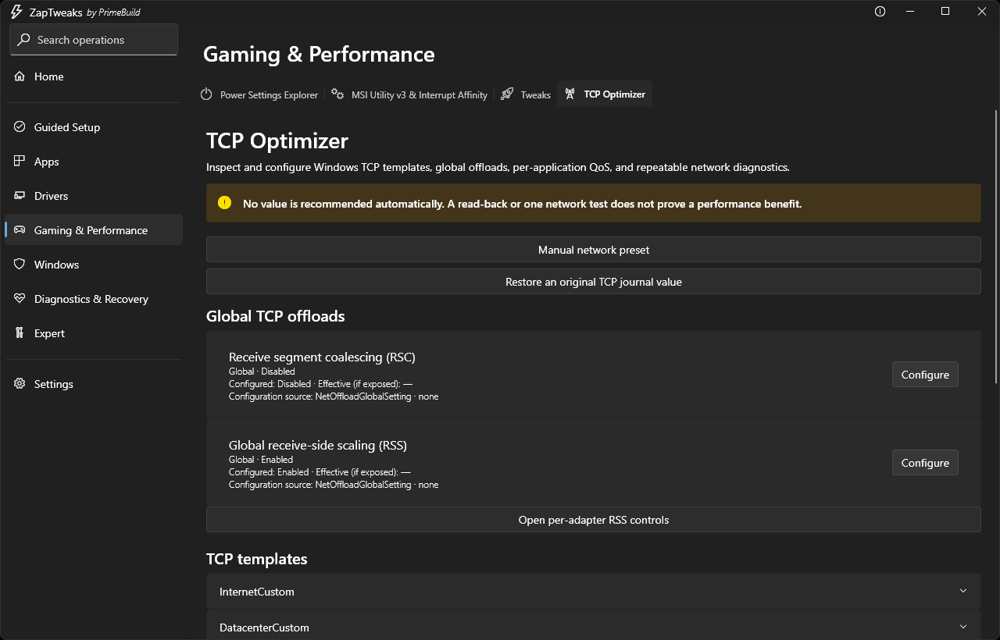
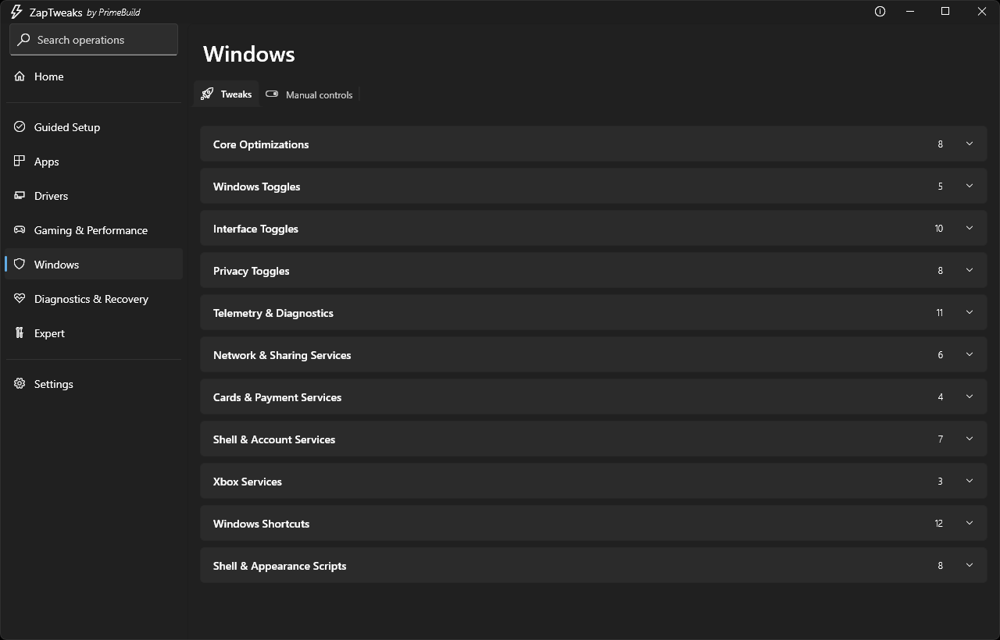
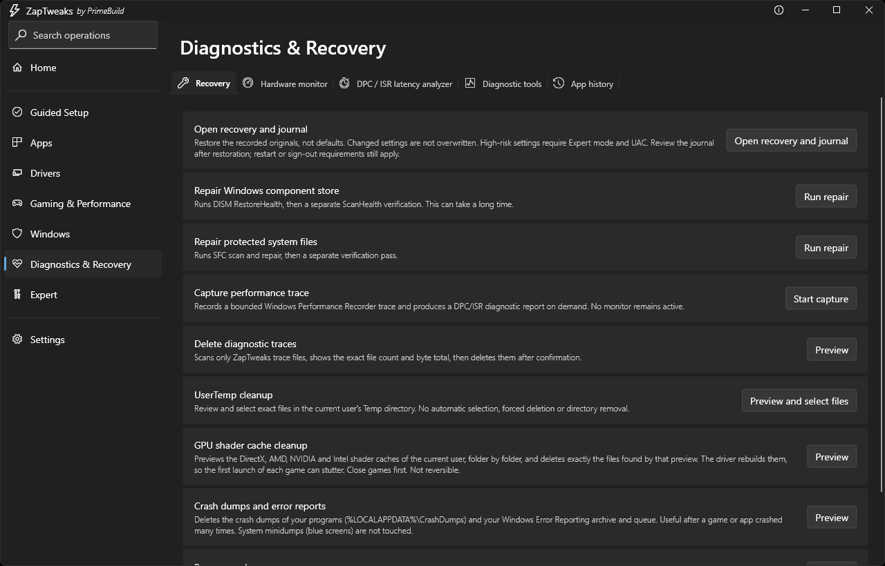
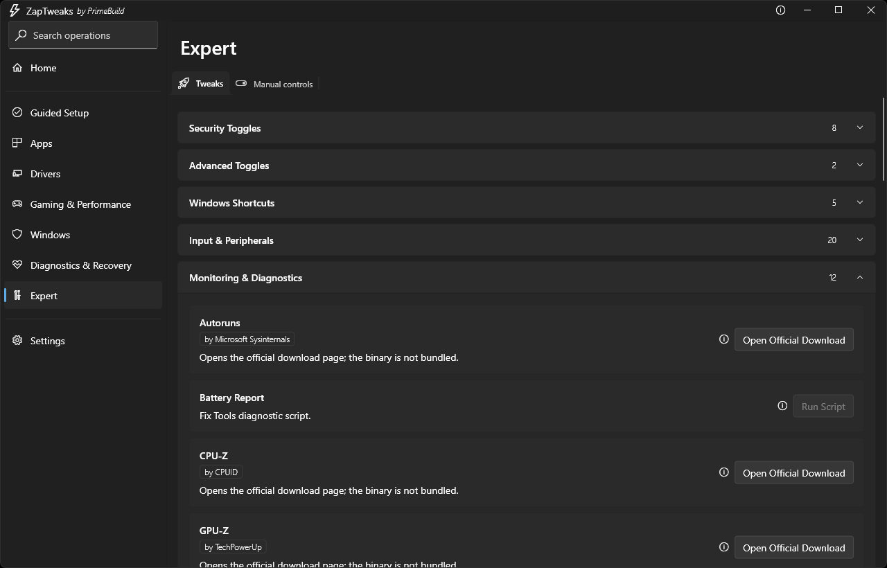
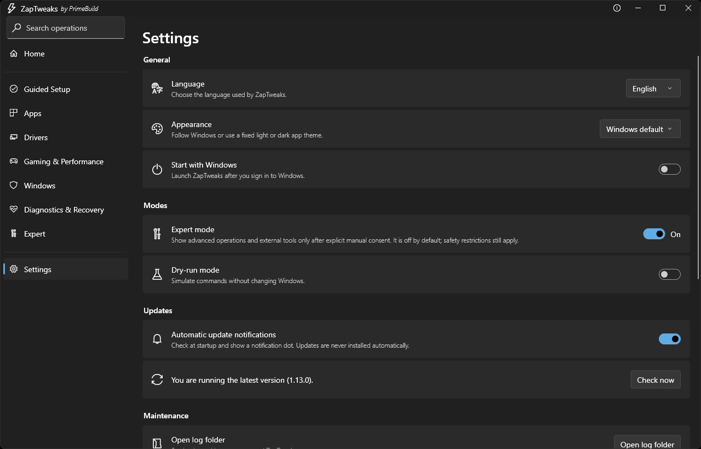

<div align="center">
  
  <p><strong>Advanced Windows 11 optimization and diagnostics companion.</strong></p>
  <p>
    <a href="https://github.com/PrimeBuild-pc/ZapTweaks/commits/main"></a>
    <a href="https://github.com/PrimeBuild-pc/ZapTweaks/stargazers"></a>
    <a href="https://github.com/PrimeBuild-pc/ZapTweaks/issues"></a>
  </p>
  <p>
    <a href="https://github.com/PrimeBuild-pc/ZapTweaks/releases/latest"></a>
    <a href="https://github.com/PrimeBuild-pc/ZapTweaks/releases"></a>
    <a href="https://github.com/PrimeBuild-pc/ZapTweaks/actions/workflows/flutter-ci.yml"></a>
    <a href="https://codecov.io/gh/PrimeBuild-pc/ZapTweaks"></a>
  </p>
  <p>
    <a href="#features"></a>
    
    <a href="https://flutter.dev/"></a>
    <a href="LICENSE"></a>
  </p>
</div>

ZapTweaks is a Windows 11 companion for gaming, latency, hardware, networking, graphics, power, diagnostics and recovery workflows. Every change is previewed, journaled and, where Windows allows it, reversible.

It is not meant to replace baseline tools such as [CTT WinUtil](https://github.com/ChrisTitusTech/winutil) or [Winhance](https://github.com/memstechtips/Winhance). Use those for broad setup and debloating, then use ZapTweaks for the deeper work. Both can be launched or installed from within the app.

## Gallery

<p align="center">
  <a href="docs/screenshots/home.png"></a>
</p>

<p align="center">
  <a href="docs/screenshots/home.png"></a>
  <a href="docs/screenshots/guided-setup.png"></a>
  <a href="docs/screenshots/apps.png"></a>
  <a href="docs/screenshots/drivers.png"></a>
  <a href="docs/screenshots/gaming.png"></a>
  <a href="docs/screenshots/tcp-optimizer.png"></a>
  <a href="docs/screenshots/windows.png"></a>
  <a href="docs/screenshots/diagnostics.png"></a>
  <a href="docs/screenshots/expert.png"></a>
  <a href="docs/screenshots/settings.png"></a>
</p>

<p align="center"><sub>Home, Guided Setup, Apps, Drivers, Gaming &amp; Performance, TCP Optimizer, Windows, Diagnostics &amp; Recovery, Expert, Settings — click a thumbnail to open it full size.</sub></p>

## Features

- **Fluent UI for Windows 11** with system, light and dark themes.
- **Live dashboard:** CPU, RAM, per-adapter GPU and VRAM readings, GPU selection, and explicit "unavailable" states instead of zeros.
- **Hardware-aware tweaks** for Intel, AMD and NVIDIA systems.
- **Safe by design:** apply/revert with state verification, a restore-point gate for aggressive operations, dry-run mode and a recovery journal that restores recorded originals rather than defaults.
- **Guided presets** with a per-PC preview (to do / already set / skipped, with the reason) and an undo.
- **Power plans:** 91 bundled plans, import/export, a hidden-settings explorer, activation and restore of the previous plan.
- **Apps and services:** app store, installed-app uninstall queue with leftover scan, optional features, startup apps, processes and a curated service safety list.
- **Drivers:** Driver Store inventory, signed-package install and export-then-remove for unbound packages.
- **Networking:** TCP templates, offloads, RSS and QoS policies with before/after diagnostics.
- **Diagnostics:** hardware monitor, DPC/ISR latency analysis, battery health, SRUM app history and repair tools (DISM, SFC).
- **Self-updating catalog and app:** the app catalog refreshes without a new release, and updates are verified before installation (see [Integrity](#catalog-and-update-integrity)).
- **Seven languages:** English, Italian, German, Spanish, French, Russian and Simplified Chinese.

## Sections

| Section | What it does |
|---|---|
| **Home** | Live metrics and detected hardware. |
| **Guided Setup** | Presets and a step-by-step setup flow. |
| **Apps** | App store, installed apps, optional features, startup apps, processes and services. |
| **Drivers** | Driver Store inventory and assisted vendor flows. |
| **Gaming & Performance** | Power Settings Explorer, MSI/interrupt affinity, TCP Optimizer and gaming tweaks. |
| **Windows** | Operating-system, privacy, telemetry and shell tweaks, plus manual controls. |
| **Diagnostics & Recovery** | Recovery journal, repairs, cleanups, hardware monitor, latency analyzer and app history. |
| **Expert** | Higher-impact operations and external tools, shown only after explicit manual consent. |
| **Settings** | Language, theme, start with Windows, Expert and dry-run modes, update checks. |

## Requirements

- Windows 11 22H2 or newer, x64
- Administrator privileges for operations that change system state

## Installation

Download the installer or the portable package from [GitHub Releases](https://github.com/PrimeBuild-pc/ZapTweaks/releases/latest), or install the latest release from an elevated PowerShell window:

```powershell
irm https://raw.githubusercontent.com/PrimeBuild-pc/ZapTweaks/main/scripts/installer-latest.ps1 | iex
```

## Safety

ZapTweaks exposes advanced settings that can affect stability, security, power use and network behavior. Read each description, create a restore point when asked, and do not apply changes you do not understand.

- NIC and device power-saving toggles back up their state locally before changing it.
- Remote-script actions show a warning before they run.
- Destructive cleanups preview the exact files first and never empty the Recycle Bin or touch system minidumps.
- Services of installed antivirus, antispyware and firewall products are always kept.
- VBIOS and NVRAM tools are launcher-only: ZapTweaks does not bundle them, choose firmware images or run flash commands. See [THIRD_PARTY_NOTICES.md](THIRD_PARTY_NOTICES.md).

## Catalog and update integrity

The app store, global search and guided setup share a catalog fetched from this repository's `main` branch. Only validated app metadata, HTTPS links and package identities are accepted; remote commands and scripts are rejected. A cached or bundled catalog stays available offline.

The updater and the PowerShell installer verify the exact official release asset, its size and the SHA-256 digest published by GitHub's HTTPS release API before launching it. The desktop updater also restricts redirects to GitHub asset hosts and rechecks the file immediately before execution. This is integrity verification against GitHub metadata, not Authenticode code signing. Each release ships a `SHA256SUMS.txt` for manual verification.

## Build from source

```powershell
flutter pub get
flutter analyze
flutter test
flutter build windows --release
```

The Windows CMake build copies the `resources` directory next to the executable. Create the portable package with:

```powershell
./build_portable.ps1 -SkipFlutterBuild
```

Release notes live in [`docs/releases`](docs/releases).

## Built with

[Flutter](https://flutter.dev/) and [Dart](https://dart.dev/), [`fluent_ui`](https://pub.dev/packages/fluent_ui), [`flutter_acrylic`](https://pub.dev/packages/flutter_acrylic), [`bitsdojo_window`](https://pub.dev/packages/bitsdojo_window), [`system_theme`](https://pub.dev/packages/system_theme), [`shared_preferences`](https://pub.dev/packages/shared_preferences), [`http`](https://pub.dev/packages/http) and [`path`](https://pub.dev/packages/path). Version constraints are in [`pubspec.yaml`](pubspec.yaml).

## License

Licensed under the [MIT License](LICENSE). Third-party tools keep their respective licenses.

## Support the project

If ZapTweaks saves you time, you can support its development:

[](https://paypal.me/PrimeBuildOfficial?country.x=IT&locale.x=it_IT)
